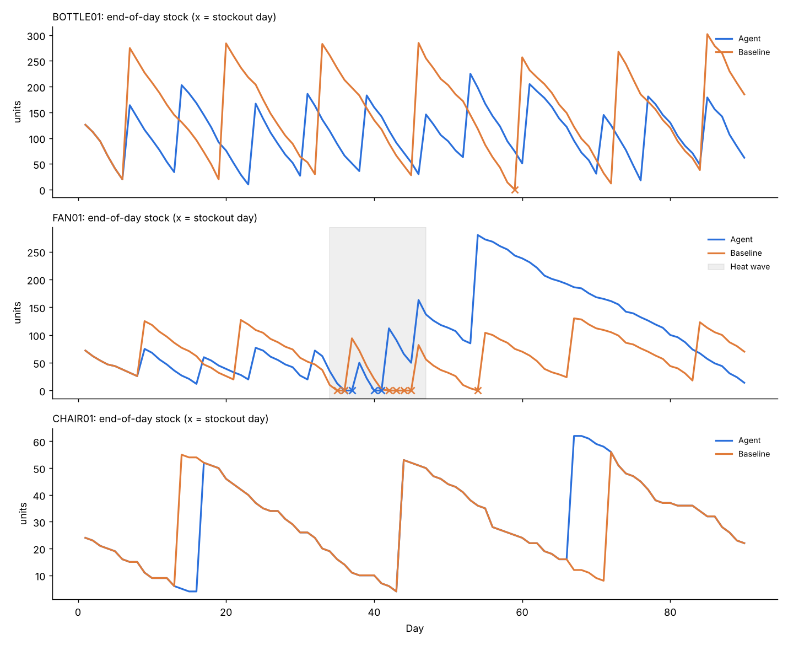

# Inventory Replenishment Agent

[](https://colab.research.google.com/github/2hv2yjnnhd-create/inventory-replenishment-agent/blob/main/replenishment_agent.ipynb)

## Project Overview
The Inventory Replenishment Agent decides every day, for each of 3 products, whether to **ORDER** more stock or **WAIT**, and writes down why. It forecasts demand with EWMA, sets safety stock from its own forecast errors and the target service level, and projects inventory over the lead time plus review period before deciding. We run it on 90 days of sales and compare it with a fixed reorder rule using the same data and costs.

Built for the Agentic AI elective at SJSU (MIS), on top of the course starter code (`supplychain.py` and `InventoryReplenishmentAgent.ipynb` from [myrah/AAI2025](https://github.com/myrah/AAI2025/tree/dev/aai)).

**Main Project Deliverable:** [replenishment_agent.ipynb](./replenishment_agent.ipynb)

**Supporting docs:** [DESIGN.md](./DESIGN.md) (1-page design) · [SCALING.md](./SCALING.md) (half-page scaling note)

## Team Members & Responsibilities
- **Eseta:**  Project Coordinator (Timeline, rubric checklist)
- **Alexia Chavez:** Dev 1 (Environment setup & API integration)
- **Brandon Le:** Dev 2 (Agents, Router, Memory implementation)
- **Andres Gomez:** Dev 1 (Environment setup & API integration)Presenter / Editor (Slides, README & Video)
- **Tanvi:** Dev 1 (Environment setup & API integration)Presenter / Editor (Slides, README & Video)

## System Architecture


### The Agent's Parts
1. **Observe (`Obs`):** each morning the agent sees stock on hand plus stock already on order. Counting stock on order is what stops it from reordering every day while a delivery is on the way.
2. **Tools (`tool_update_forecast`, `tool_safety_stock`):** an EWMA forecast (alpha 0.3) that only uses past sales, and safety stock = z(service level) x std of the last 28 forecast errors x sqrt(lead time + review period).
3. **Decide (`ReplenishmentAgent.decide`):** if projected stock at the end of the lead time + 1 day falls below safety stock, order up to the reorder point plus 7 days of demand. Otherwise wait.
4. **Guardrails:** orders are rounded up to the MOQ, arrive exactly `lead_time_days` later, and can't push stock past 30 days of forecast demand. If the MOQ alone breaks the cap, the agent waits while it safely can, then orders and logs `CAP OVERRIDE` for review.
5. **Learn (`Memory`):** at the end of each day it stores the forecast error and updates the forecast.
6. **Baseline (`BaselinePolicy`):** a fixed (s, Q) rule set on day 1 from the same demand guess and service level. It counts stock on order too, so it's a fair comparison. It just never updates.

### Our 3 SKUs
| SKU | Pattern | Lead time | MOQ | Service level |
|---|---|---|---|---|
| BOTTLE01 | Steady seller, about 20/day, busier weekends | 5 days | 60 | 95% |
| FAN01 | About 8/day, then a 2-week heat wave at about 3x (Aug 3 to 16) | 7 days | 40 | 95% |
| CHAIR01 | Slow mover, about 1.5/day | 10 days | 50 | 90% |

## Results (90 days, 3 SKUs)

| Metric | Agent | Baseline |
|---|---|---|
| Stockout days | 4 | 8 |
| Unmet demand (units) | 49 | 119 |
| Fill rate | 98.4% | 96.0% |
| Purchase orders | 25 | 17 |
| Avg $ tied up in stock | $6,724.01 | $6,150.30 |
| Holding cost | $1,658.00 | $1,510.36 |
| Stockout cost | $735.00 | $1,731.00 |
| Order cost | $0.00 | $0.00 |
| **Total cost** | **$2,393.00** | **$3,241.36** |

The agent lowered total cost by $848.36 and lost 70 fewer units. It didn't win everywhere: it tied up more money in stock (mostly fans left over after the heat wave), and on CHAIR01 it cost $25.00 more than the baseline. The reflection at the end of the notebook explains why.



**Trade-off runs** (agent, all SKUs, `outputs/tradeoff.csv`):

| Service level | Alpha | Fill rate | Unmet units | Avg $ in stock | Total cost |
|---|---|---|---|---|---|
| 90% | 0.1 | 97.7% | 69 | $5,661 | $2,423.15 |
| 90% | 0.3 | 98.3% | 52 | $6,550 | $2,397.16 |
| 90% | 0.5 | 97.7% | 68 | $8,151 | $2,693.68 |
| 95% | 0.1 | 97.9% | 64 | $5,830 | $2,397.02 |
| 95% | 0.3 | 98.4% | 49 | $6,724 | $2,393.00 |
| 95% | 0.5 | 98.2% | 55 | $8,360 | $2,639.40 |
| 99% | 0.1 | 98.1% | 58 | $6,118 | $2,374.85 |
| 99% | 0.3 | 98.6% | 43 | $7,046 | $2,378.86 |
| 99% | 0.5 | 98.8% | 37 | $8,738 | $2,559.42 |

## Test Results & Output Proof
Real output from the notebook run (the full log covers every SKU, every day).

```text
============================================================
TEST 1: DAILY AGENT LOG (first days of BOTTLE01)
============================================================

===== Replenishment agent | BOTTLE01 | opening stock 150 | lead time 5 days | MOQ 60 | service level 95% =====
Day  1 2026-07-01 | BOTTLE01 | stock 150 | on order   0 | fcst  20.0/day | SS 18.0 | WAIT | sold 24/24
        Reason: WAIT. Projected stock after 6 days is 30, above safety stock 18. Ordering now would only add holding cost.
Day  2 2026-07-02 | BOTTLE01 | stock 126 | on order   0 | fcst  21.2/day | SS 18.6 | ORDER 169, arrives day 7 | sold 14/14
        Reason: ORDER. Projected stock after 6 days is -1, below safety stock 19. Ordering up to target 294 (169 units).
Day  3 2026-07-03 | BOTTLE01 | stock 112 | on order 169 | fcst  19.0/day | SS 17.6 | WAIT | sold 18/18
        Reason: WAIT. Projected stock after 6 days is 167, above safety stock 18. Ordering now would only add holding cost.

============================================================
TEST 2: DEMAND SPIKE (FAN01 heat wave starts Aug 3)
============================================================

Day 34 2026-08-03 | FAN01 | stock  62 | on order  72 | fcst   8.3/day | SS 15.5 | WAIT | sold 27/27
        Reason: WAIT. Projected stock after 8 days is 68, above safety stock 16. Ordering now would only add holding cost.
Day 35 2026-08-04 | FAN01 | stock  35 | on order  72 | fcst  13.9/day | SS 22.5 | ORDER 124, arrives day 42 | sold 22/22
        Reason: ORDER. Projected stock after 8 days is -4, below safety stock 22. Ordering up to target 231 (124 units).
Day 36 2026-08-05 | FAN01 | stock  13 | on order 196 | fcst  16.3/day | SS 23.3 | WAIT | sold 13/24, LOST 11
        Reason: WAIT. Projected stock after 8 days is 78, above safety stock 23. Ordering now would only add holding cost.

============================================================
TEST 3: GUARDRAIL (MOQ vs inventory cap on CHAIR01)
============================================================

Day  7 2026-07-07 | CHAIR01 | stock  16 | on order   0 | fcst   1.8/day | SS  5.6 | ORDER 50, arrives day 17 | sold 1/1
        Reason: ORDER. Projected stock after 11 days is -3, below safety stock 6. Ordering up to target 37, rounded up to MOQ 50. CAP OVERRIDE: MOQ 50 pushes stock past cap 53, but position 16 no longer covers expected demand of 19. Flag for review.

============================================================
TEST 4: BUILT-IN CHECKS
============================================================

agent BOTTLE01: all checks passed (12 orders, 0 cap overrides)
agent FAN01: all checks passed (9 orders, 0 cap overrides)
agent CHAIR01: all checks passed (4 orders, 2 cap overrides)
baseline BOTTLE01: all checks passed (7 orders, 0 cap overrides)
baseline FAN01: all checks passed (7 orders, 0 cap overrides)
baseline CHAIR01: all checks passed (3 orders, 0 cap overrides)

WARNING: 1 negative qty_sold values set to 0
Note: 1 duplicate date/SKU rows were added together
Note: BOTTLE01 has 1 dates with no sales row, treated as zero demand
Note: CHAIR01 has 16 dates with no sales row, treated as zero demand
Note: FAN01 has 1 dates with no sales row, treated as zero demand
Data validation check passed
```

The checks assert, for both the agent and the baseline, that every order arrives exactly `lead_time_days` later and in full, every order meets the MOQ, inventory balances every day, costs match their definitions, every day has an action and a reason, the forecast only uses past sales, and the cap is only exceeded with a logged override. Test 4's warnings come from a deliberately broken sales file that the loader is supposed to catch.

## Setup & Run Instructions

**Google Colab (easiest):** click the badge at the top, then **Runtime > Run all**. You don't need to upload anything. If the CSVs aren't in a `data/` folder next to the notebook, Step 1 recreates them with a fixed seed, so you get exactly the same numbers.

**On your computer:**
1. Clone the repository:
   ```bash
   git clone https://github.com/2hv2yjnnhd-create/inventory-replenishment-agent.git
   cd inventory-replenishment-agent
   ```
2. Install the requirements:
   ```bash
   pip install -r requirements.txt
   ```
3. Run it:
   ```bash
   python replenishment_agent.py          # or open replenishment_agent.ipynb in Jupyter / VS Code
   ```
   The script prints the daily log and tables, then opens the chart. Close the chart window to let it finish. Results are saved to `outputs/`.

No API keys are needed.

**Settings you can change** (top of the notebook, Step 0): `ALPHA`, `REVIEW_PERIOD_DAYS`, `CAP_DAYS_OF_DEMAND`, `CYCLE_COVER_DAYS`, `FIXED_ORDER_COST`, `SERVICE_LEVEL_OVERRIDE`, `LEAD_TIME_OVERRIDE`, the planner's starting forecast, and the baseline order size. Per-SKU costs, lead time, MOQ, and service level are in `data/params.csv`.

## Repository Structure
```text
inventory-replenishment-agent/
├── replenishment_agent.ipynb         # main deliverable, already run with outputs saved
├── replenishment_agent.py            # same code as a plain Python script
├── DESIGN.md                         # 1-page design: goal, inputs, outputs, guardrails, metrics, ethics
├── SCALING.md                        # half-page plan for running this in the cloud
├── Agent Architecture Diagram.png
├── requirements.txt
├── data/
│   ├── README.md                     # what each column means
│   ├── sales.csv                     # date, sku, qty_sold
│   ├── inventory.csv                 # sku, opening_stock
│   └── params.csv                    # costs, lead time, MOQ, service level per SKU
└── outputs/
    ├── agent_log.csv                 # one row per SKU per day: action, reason, costs
    ├── baseline_log.csv              # same format, for the fixed rule
    ├── comparison.csv                # agent vs baseline, per SKU and total
    ├── tradeoff.csv                  # service level x alpha runs
    └── inventory_chart.png
```

**Assumptions:** duplicate date/SKU rows are added together, a date with no sales row means zero demand, negative or missing sales are set to 0 with a warning, and unmet demand is lost (not backordered).

## Fixes to the Starter Code

| Starter file | Problem | Fix here |
|---|---|---|
| `supplychain.py` | Decided using on-hand stock only and ignored orders already in transit, so it reordered every day while a delivery was on the way | Decisions use **inventory position** (on hand + on order) |
| `supplychain.py` | Only logged ORDER days | **Every day** gets a logged action and reason, including WAIT |
| `supplychain.py` | Safety stock used sqrt(lead time) instead of sqrt(lead time + review period) | Uses **sqrt(lead time + review period)** |
| `supplychain.py` | No baseline and no stockout-day count | Added a fixed (s, Q) **baseline** and **stockout days** |
| `supplychain.py` | Forecast errors were measured against a forecast that already included that day's sales, so errors looked smaller than they were (by a factor of 1 - alpha), and the first day's error spread was filled in from all 90 days (future data) | Each error compares the day's sales with the forecast made **before** that day, and an assert checks the forecast only uses past sales |
| `supplychain.py` | z-score from a small hard-coded lookup table | Uses `scipy.stats.norm.ppf(service_level)` |
| `Inventory_Replenishment_Agent.ipynb` | Safety stock from the std of **absolute** errors, which shrinks the real spread | Uses the std of **signed** errors (actual minus forecast) |
| `Inventory_Replenishment_Agent.ipynb` | Skipped the order when the needed quantity was below the MOQ | **Rounds up** to the MOQ |
